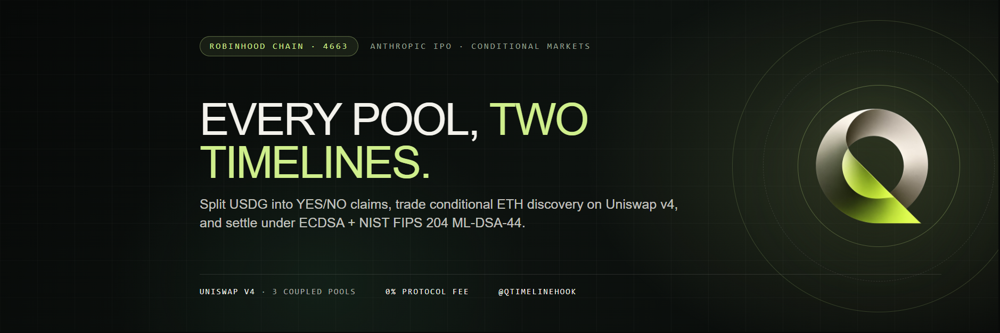
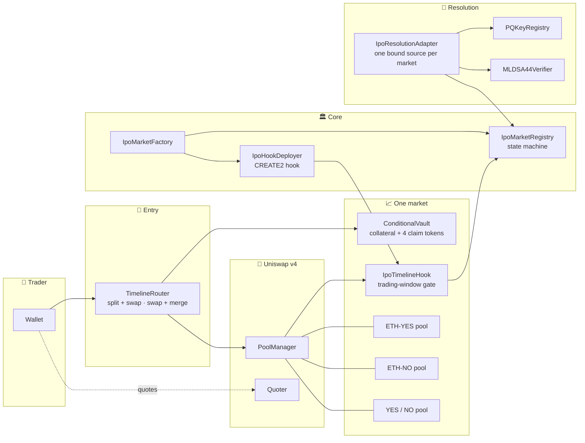
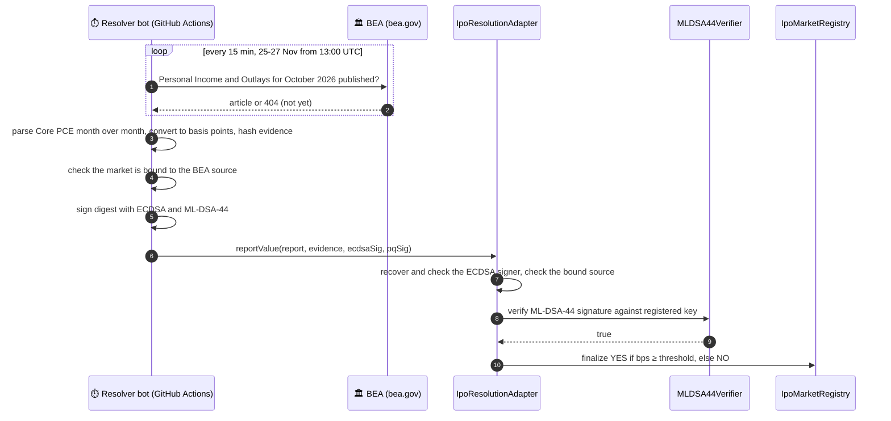

<div align="center">



<br />

# QTIMELINE

**Prediction markets on Uniswap v4 for Robinhood Chain**

*Bet on the number before it prints. Settled onchain from the official source, not by a vote.*

🌐 **App:** [www.qtimeline.tech](https://www.qtimeline.tech) · 📈 **Market:** [`/market`](apps/web/app/market/page.tsx) · 💼 **Positions:** [`/positions`](apps/web/app/positions/page.tsx) · 📜 **Rules:** [`/rules`](apps/web/app/rules/page.tsx)

*A prediction market built from three Uniswap v4 pools. Collateral is split into YES and NO claims, the market is resolved onchain from an official release, and the result needs two signatures: one classical, one post-quantum.*

[](#-live-robinhood-mainnet-deployment-chain-id-4663)
[](#-tech-stack)
[](#-protocol-architecture)
[](#-smart-contracts)
[](#-how-a-market-resolves)

</div>

---

## ⚡ Overview

**QTimeline** turns one yes-or-no question about a real-world number into three tradable Uniswap v4 pools on Robinhood Chain (4663). The market that is open now asks:

> **Will US Core PCE rise at least 0.30% month over month in October 2026?**

Core PCE is the inflation gauge the Fed watches most closely. The US Bureau of Economic Analysis (BEA) publishes the October figure on **25 Nov 2026 at 13:30 UTC** (08:30 ET).

1. **Collateral becomes claims.** One USDG (or one ETH) splits into a YES claim and a NO claim. After the result, the winning claim redeems 1 : 1 and the losing claim is worth zero. Matching pairs can merge back into collateral at any time before the result.
2. **Three pools per market.** An **ETH-YES** pool prices ETH if the threshold is met, an **ETH-NO** pool prices ETH if it is not, and a **YES / NO** pool is the market's implied odds. Every pool is a standard Uniswap v4 pool with a 0.30% LP fee and no protocol fee.
3. **One trading window, enforced by a hook.** A per-market hook rejects swaps before the market opens and after the cutoff, even if someone calls the PoolManager directly. Trading stops 5 minutes before the BEA release.
4. **Resolved from an official release.** A bot reads the first BEA Personal Income and Outlays release, takes the printed month-over-month Core PCE, and signs the report twice. The adapter verifies both signatures onchain before the market moves to YES or NO.
5. **Cancelled safely.** If no result arrives within 48 hours of the release, anyone can cancel and every claim redeems for 50 cents.

### One engine, many events

The contracts are a shared event engine. **A new event is a new market, not a new deployment.** Each market is bound to one data source (`bea:core-pce:mom:first-release` for this one), carries its own schedule, and accepts a signed threshold of any sign, including zero and negative values. The Anthropic IPO market that ran first is now a [past market](#-past-markets) on the same contracts. Contract names keep the `Ipo` prefix from that first market; they are the engine.

---

## 🏛️ Core Value Proposition

* **Settlement follows a public document.** For this market the only input that can resolve it is the first BEA release for October 2026. The bot parses one number, hashes the evidence, and publishes both.
* **A source is bound to each market.** `IpoResolutionAdapter` stores the data source of every market. A report from another source (for example an SEC filing) cannot resolve a BEA market, and the other way round.
* **Two signatures, checked onchain.** The adapter accepts a report only when the ECDSA signature and the ML-DSA-44 (NIST FIPS 204) signature both verify, the latter through `MLDSA44Verifier`.
* **Trading stops before the answer exists.** The hook closes the pools at the cutoff, 5 minutes before the release, so nobody trades against a known number.
* **Hard collateral caps.** The factory refuses any market with caps above 0.1 ETH or 500 USDG of collateral, and the caps are bound into the market's config hash. Exposure is bounded by design.
* **A way out for everyone.** The hook does not implement `beforeRemoveLiquidity`, so it cannot block a liquidity withdrawal. Cancelled markets pay 50 cents per claim.
* **Quotes come from the pool.** The odds shown in the app are read from the market's own YES / NO pool through the official Uniswap v4 Quoter. No outside price feed is involved.

---

## 🔬 Protocol Architecture



### Trade routes

Every trade goes through `TimelineRouter`. Each call checks the market's config hash, status, deadline, a per-wallet nonce and a minimum output.

| Action | Router call | What happens |
|---|---|---|
| Bet on the outcome (buy) | `buyProbability` | Splits USDG into YES + NO, swaps the unwanted side in the YES / NO pool, and sends you the claims |
| Bet on the outcome (sell) | `sellProbability` | Swaps part of your position, merges the matching pair, and returns USDG |
| Buy conditional ETH | `tradeAsset` | Splits USDG, swaps the claim on one side for ETH in that world |
| Sell conditional ETH | `closeConditional` | Swaps ETH claims back to USDG claims and merges with the paired claim |

### Market lifecycle

| Status | Meaning |
|---|---|
| Scheduled | Activated, before `opensAt`. Swaps are rejected. |
| Open | Between `opensAt` and `cutoffAt`. `syncTime` is permissionless and the app sends it with the first trade. |
| Awaiting result | After `cutoffAt`. Swaps are rejected. The earliest report is accepted at `releaseAt`. |
| Final YES / Final NO | A valid dual-signed report arrived. Winning claims redeem 1 : 1. |
| Cancelled | No valid report by `deadline`. Every claim redeems for 50 cents. |

**Schedule bounds.** The registry and factory accept a per-market schedule inside fixed bounds: cutoff to earliest report 5 minutes to 7 days, and a reporting window of 1 to 14 days. The market must open at least 12 hours before the cutoff.

**Core PCE market, October 2026, all times UTC:**

| Event | Time |
|---|---|
| Trading opens | 24 Nov 2026, 09:56 UTC |
| Trading closes | 25 Nov 2026, 13:25 UTC (08:25 ET) |
| BEA release, earliest report accepted | 25 Nov 2026, 13:30 UTC (08:30 ET) |
| Cancellation opens | 27 Nov 2026, 13:30 UTC |

---

## 🔏 How a Market Resolves



Values are signed integers in the unit the source reports, so `0.30%` is `30` basis points. A source other than the SEC may report zero or a negative value. The adapter rejects a report whose source ID is not the one the market is bound to, whose period does not match, or whose EIP-712 domain belongs to another adapter.

One workflow handles every event on the shared engine: [`.github/workflows/resolve-mainnet-event.yml`](.github/workflows/resolve-mainnet-event.yml). The data source is chosen per run (`sec` or `bea`), and the resolver refuses to sign when the market is not bound to that source onchain. See [`ops/resolver/README.md`](ops/resolver/README.md).

---

## 🕰️ Past Markets

| Market | Result | What holders can do |
|---|---|---|
| **Anthropic IPO price at or above $74.00** | **Cancelled.** No Form 424B4 was reported before the 21 Nov deadline. | Every claim redeems for 50 cents. Open [`/positions/?id=0x19d1…eafa`](https://www.qtimeline.tech/positions/?id=0x19d1b881668c8c8c776c92c1745daf74933b2c40c82065ba5f6017ee5e6aeafa) and redeem. |

The app lists ended markets in a **Past markets** section with a link to the explorer and a button that opens the claims for that market.

---

## 🖥️ Platform Interfaces

| Page | Purpose |
|---|---|
| [`/`](apps/web/app/page.tsx) | Landing page: what the app is in one line, a live countdown to the cutoff, **Release day** (the four moments of a market and the three ways it ends), architecture, past markets |
| [`/market`](apps/web/app/market/page.tsx) | The question, one-tap **Buy YES / Buy NO** with live odds, the trade ticket, the three pools, past markets |
| [`/positions`](apps/web/app/positions/page.tsx) | Your four claim balances, merge before the result, redeem after it. `?id=<marketId>` opens any market, including ended ones |
| [`/rules`](apps/web/app/rules/page.tsx) | Rules, payouts and risks in plain language |
| [`/vote`](apps/web/app/vote/page.tsx) | QTL voting, unavailable until the QTL token is verified |
| [`/bea-proof`](apps/web/app/bea-proof/page.tsx) | Archived BEA fixtures for the Core PCE parser |

The market page has two trade modes. **Bet on the outcome** buys YES or NO shares in the odds pool and is the default. **Trade ETH · advanced** buys or sells ETH that only exists in the YES or NO world. The ETH pools are shallow (about 0.0045 ETH, roughly $8, of liquidity each at launch), so quick amounts there are 1, 2 and 5 USDG and larger amounts show a clear message instead of a quote. Wallet discovery uses EIP-6963 with a legacy `window.ethereum` fallback. All times in the app are shown in US Eastern time.

---

## 📁 Repository Structure

```text
QTimeline/
├── apps/
│   └── web/                      # Static Next.js export, one build per event
│       ├── app/                  # /, /market, /positions, /vote, /rules, /bea-proof
│       ├── components/           # QuickBet, MarketTradePanel, PositionsPanel, PastMarkets, landing/*
│       └── lib/                  # event-profile, past-markets, odds, wallet (EIP-1193 / EIP-6963), errors
├── contracts/
│   ├── src/
│   │   ├── ipo/                  # Shared event engine (upgradeable, live on mainnet)
│   │   ├── MarketRegistry.sol    # Original Core PCE system (immutable, testnet only)
│   │   ├── MLDSA44Verifier.sol   # FIPS 204 verifier
│   │   └── libraries/
│   ├── test/                     # Foundry unit, fuzz, invariant and mainnet-fork tests
│   ├── scripts/                  # deploy, upgrade, market create, withdraw, quote, release checks
│   └── lib/evm-ml-dsa-verifier/  # ML-DSA-44 verifier (git submodule)
├── ops/resolver/                 # SEC and BEA parsers, signing and report submission
├── packages/chain/               # Robinhood Chain config and shared ABIs
├── deployments/
│   └── robinhood-mainnet-ipo.json  # Live mainnet manifest: base system, events, upgrade history
├── .github/workflows/            # resolve-mainnet-event, deploy-web, CI
└── docs/
    ├── qtimeline_report.md       # Project report and architecture overview
    ├── submission_package.txt    # Submission and handover report
    └── OPERATIONS.md             # Release runbook, next-event steps, rehearsal evidence
```

---

## 🛠️ Tech Stack

| Layer | Technology |
|---|---|
| Web | Next.js 15.5 static export · React 19 · TypeScript 5.9 (strict) · viem 2.57 · GSAP · Lenis · three.js |
| Contracts | Solidity 0.8.30 · EVM `osaka` · via-IR · optimizer 10,000 runs · Foundry 1.7.1 |
| AMM | Uniswap v4 core 1.0.2 · periphery 1.0.3 |
| Libraries | OpenZeppelin Contracts and Upgradeable 5.4.0 |
| Signatures | ECDSA secp256k1 + ML-DSA-44 (FIPS 204), verifier by Fireblocks Labs (submodule) |
| Resolver | Node 24 · GitHub Actions on a protected Environment |
| Hosting | Cloudflare Pages, deployed from GitHub Actions on every push to `main` |
| Package manager | pnpm 9.15 workspace |

---

## 🚀 Quickstart & Local Development

### Prerequisites

* Node 24 and pnpm 9.15
* [Foundry](https://book.getfoundry.sh/) 1.7.1
* Git with submodule support

### 1. Install

```sh
git clone --recurse-submodules https://github.com/Quantum-Timeline/QTimelineHook.git
cd QTimelineHook
pnpm install
```

### 2. Run the frontend

```sh
pnpm dev
```

### 3. Compile and test the contracts

```sh
pnpm contracts:build
pnpm contracts:test
```

### 4. Run the Node tests

```sh
pnpm contracts:test:release
pnpm --filter @qtimeline/resolver test
```

### 5. Check types

```sh
pnpm typecheck
```

The mainnet fork tests need an RPC URL in `contracts/.env`:

```sh
pnpm contracts:test:mainnet-fork
```

### 6. How the site picks an event

The site is a static export, and one build shows one event. The event comes from build variables:

| Variable | Example | Meaning |
|---|---|---|
| `NEXT_PUBLIC_EVENT_PROFILE` | `ipo` | Selects the shared-engine UI |
| `NEXT_PUBLIC_EVENT_KIND` | `pce` | Switches the copy to the Core PCE market |
| `NEXT_PUBLIC_MARKET_ID` | `0xc8fd…fcee` | The market the page trades |
| `NEXT_PUBLIC_EVENT_THRESHOLD_BPS` | `30` | The threshold in basis points |
| `NEXT_PUBLIC_EVENT_PERIOD_LABEL` | `October 2026` | The period shown in copy |
| `NEXT_PUBLIC_EVENT_CUTOFF_AT` | `1795613100` | Cutoff in unix seconds, for the countdown |

Production values live in GitHub repository variables and are built by [`deploy-web.yml`](.github/workflows/deploy-web.yml).

### 7. Run the next event, with no redeploy

```sh
# 1. Plan, then create, seed and activate the market on the existing contracts
export QT_EVENT_KEY=core-pce-2026-11          # manifest.events[key]
export QT_IPO_PERIOD=CORE-PCE-2026-11         # period string encoded in the market
export QT_IPO_CUTOFF_AT=<unix>                # last moment of trading
export QT_EVENT_RELEASE_AT=<unix>             # earliest report, 5 minutes to 7 days after the cutoff
export QT_EVENT_THRESHOLD_BPS=<signed int>    # in the unit the source reports, for example 30 for 0.30%
export QT_EVENT_SOURCE_ID=bea:core-pce:mom:first-release
export QT_ETH_USD=<reference ETH price>
pnpm market:ipo:plan
pnpm market:ipo:create

# 2. Point the web build at it
QT_EVENT_KIND=pce QT_EVENT_PERIOD_LABEL="November 2026" pnpm web:ipo:configure
```

Then update the repository variables used by the resolver workflow and the web build. The full runbook is in [`docs/OPERATIONS.md`](docs/OPERATIONS.md).

---

## 📜 Smart Contracts

The shared event engine lives in [`contracts/src/ipo/`](contracts/src/ipo/).

| Contract | Role |
|---|---|
| `IpoMarketFactory` | Creates a market from a config signed with ECDSA and ML-DSA-44, initializes the three pools, activates the market. Accepts per-market schedules inside the bounds |
| `IpoMarketRegistry` | Market state machine, schedule bounds, permissionless `syncTime`, finalization and cancellation |
| `IpoConditionalVault` | Holds the collateral and mints four claim tokens (ETH-YES, ETH-NO, USDG-YES, USDG-NO). `split`, `merge`, `redeem` |
| `IpoOutcomeToken` | The claim token, mintable and burnable only by its vault. Named neutrally, for example "QTimeline ETH YES" |
| `IpoTimelineHook` | Uniswap v4 hook with flags `0x2880`: `beforeInitialize`, `beforeAddLiquidity`, `beforeSwap`. Rejects swaps outside the trading window |
| `IpoHookDeployer` | Deploys one hook per market at a CREATE2 address that satisfies the v4 permission bits |
| `IpoTimelineRouter` | Single trade entry point with config hash, status, deadline, nonce and slippage checks |
| `IpoResolutionAdapter` | Verifies the dual-signed report, enforces the source bound to each market (`setMarketSource`, once, before the earliest report) and finalizes the market |
| `IpoPQKeyRegistry` | Registered post-quantum public keys, sealed after setup |
| `MLDSA44Verifier` | NIST FIPS 204 ML-DSA-44 signature verification |

The original Core PCE contracts (`MarketRegistry`, `MarketFactory`, `ResolutionAdapter`, `TimelineRouter` and others) are an immutable predecessor system. They are tested on Robinhood Testnet and on a mainnet fork and are **not deployed on mainnet**. The live Core PCE market runs on the engine above.

---

## 🌐 Live Robinhood Mainnet Deployment (Chain ID: 4663)

Manifest: [`deployments/robinhood-mainnet-ipo.json`](deployments/robinhood-mainnet-ipo.json)

| Contract | Proxy / address | Deploy block |
|---|---|---|
| IpoMarketFactory | [`0xDb882dBD0da7ed65d4C360b5B18B9bd93ceAFde6`](https://robinhoodchain.blockscout.com/address/0xDb882dBD0da7ed65d4C360b5B18B9bd93ceAFde6) | 114,258,173 |
| IpoMarketRegistry | [`0x5444CF6E91462938C975668266c9E24b6233BD37`](https://robinhoodchain.blockscout.com/address/0x5444CF6E91462938C975668266c9E24b6233BD37) | 114,258,161 |
| IpoResolutionAdapter | [`0x741C847f54CeebD6A4D1A32341f73fb62eb80fbA`](https://robinhoodchain.blockscout.com/address/0x741C847f54CeebD6A4D1A32341f73fb62eb80fbA) | 114,258,179 |
| TimelineRouter | [`0x401a0A3A8e32ABaA7f66EE7247D592f47784DF45`](https://robinhoodchain.blockscout.com/address/0x401a0A3A8e32ABaA7f66EE7247D592f47784DF45) | 114,258,185 |
| PQKeyRegistry | [`0x78F42d96AD69Ed3D696875CF59eFF8A447Cd80A8`](https://robinhoodchain.blockscout.com/address/0x78F42d96AD69Ed3D696875CF59eFF8A447Cd80A8) | 114,258,167 |
| MLDSA44Verifier | [`0x668Fe10f9b424349FDD41F7E6C5DF2cC21Bf3214`](https://robinhoodchain.blockscout.com/address/0x668Fe10f9b424349FDD41F7E6C5DF2cC21Bf3214) | 114,257,982 |
| IpoHookDeployer | [`0xaAa28FA6a7DB709129879c1daF13Bc90B843064f`](https://robinhoodchain.blockscout.com/address/0xaAa28FA6a7DB709129879c1daF13Bc90B843064f) | 114,258,133 |
| F1600Helper | [`0x0438deB1f25BA0D88D257acfe89191B3EB3de75F`](https://robinhoodchain.blockscout.com/address/0x0438deB1f25BA0D88D257acfe89191B3EB3de75F) | 114,257,972 |

### Upgrades for the shared event engine (24 Nov 2026)

Three proxies were upgraded by the deployer to add per-market source binding, per-market schedule bounds and signed thresholds of any sign. The new implementations are confirmed by reading the proxies back from chain. Storage layout was preserved.

| Proxy | New implementation | Upgrade tx |
|---|---|---|
| IpoResolutionAdapter | [`0x0087A0a7544322c0361616Ca1C7f5cf8Fd95d529`](https://robinhoodchain.blockscout.com/address/0x0087A0a7544322c0361616Ca1C7f5cf8Fd95d529) | [`0xd45f18da…13d5d5`](https://robinhoodchain.blockscout.com/tx/0xd45f18da317de6402d3289c95d89b54b9a66cc58013ea8ffdb74189f9b13d5d5) |
| IpoMarketRegistry | [`0x7055Eb3b51589c6715ca6AD119fa8547cE14D202`](https://robinhoodchain.blockscout.com/address/0x7055Eb3b51589c6715ca6AD119fa8547cE14D202) | [`0x078eace7…cd4aea`](https://robinhoodchain.blockscout.com/tx/0x078eace72a6d9ad6491dc0cd609275e35bc02d4ce0a0048bb77f4b859bcd4aea) |
| IpoMarketFactory | [`0x20499D3fB06Fd0830553eBf8Aac0BF52A6ea852a`](https://robinhoodchain.blockscout.com/address/0x20499D3fB06Fd0830553eBf8Aac0BF52A6ea852a) | [`0xa38e4a2b…a9c59a`](https://robinhoodchain.blockscout.com/tx/0xa38e4a2b0bc4be934420172ce2f651cda962d1b2ddeebceca37fb3804fa9c59a) |

The `implementations` block of the manifest records the original implementations; `upgradeHistory` records these upgrades.

### The live market: US Core PCE, October 2026

| | |
|---|---|
| Market ID | `0xc8fdedaeb42752167dd111603983166c4529ae4da59820328fa75385cac4fcee` |
| Period | `CORE-PCE-2026-10` |
| Threshold | 0.30% (`30` basis points) |
| Bound source | `bea:core-pce:mom:first-release` |
| Hook | [`0x824Bc382bEfbF478BA24309C0CF68C04a2F76880`](https://robinhoodchain.blockscout.com/address/0x824Bc382bEfbF478BA24309C0CF68C04a2F76880) |
| Vault | [`0xA127EeB1084623E8C6d141501410Fde98164C3Ab`](https://robinhoodchain.blockscout.com/address/0xA127EeB1084623E8C6d141501410Fde98164C3Ab) |
| ETH-YES claim | [`0xCcC3bd893c5aa1A4eE109Be4FAc2655E615d446B`](https://robinhoodchain.blockscout.com/address/0xCcC3bd893c5aa1A4eE109Be4FAc2655E615d446B) |
| ETH-NO claim | [`0xF036A7677904a2fe7807b792f092633243Ba0119`](https://robinhoodchain.blockscout.com/address/0xF036A7677904a2fe7807b792f092633243Ba0119) |
| USDG-YES claim | [`0x928FaB302AFe89a571E99eBaFcaA6E0818d3ba76`](https://robinhoodchain.blockscout.com/address/0x928FaB302AFe89a571E99eBaFcaA6E0818d3ba76) |
| USDG-NO claim | [`0x58564d1C266139e28fb46387fFfb1c9AbBf383c6`](https://robinhoodchain.blockscout.com/address/0x58564d1C266139e28fb46387fFfb1c9AbBf383c6) |
| LP position NFTs | 4355306, 4355307, 4355308 (PositionManager) |
| Opening seed | 28 USDG and about 0.0045 ETH, ETH reference price 1,778.03 USDG |
| Create tx · block 122,102,641 | [`0x82822c94…bc48644`](https://robinhoodchain.blockscout.com/tx/0x82822c94374eb066a29ddf8810c7e81f913a1bbee3ac128bfc04d5140bc48644) |
| Bind source tx | [`0x9c1d93dd…eb577f`](https://robinhoodchain.blockscout.com/tx/0x9c1d93dda63a1b32c01bb7925fea09fe16c21c45fc16413dd2dbc45a52eb577f) |
| Activate tx | [`0xcf277d13…ab6b59`](https://robinhoodchain.blockscout.com/tx/0xcf277d13786969ad3fb1771ffe7c664b3685f7457a51d21abbb77c87fdab6b59) |

### The past market: Anthropic IPO price (cancelled)

| | |
|---|---|
| Market ID | `0x19d1b881668c8c8c776c92c1745daf74933b2c40c82065ba5f6017ee5e6aeafa` |
| Threshold | $74.00 (`7400` cents) |
| Vault | [`0x7ACf9Dca7A456175ED66BbEc8B8600C9Fe6e5c0d`](https://robinhoodchain.blockscout.com/address/0x7ACf9Dca7A456175ED66BbEc8B8600C9Fe6e5c0d) |
| Result | Cancelled after the 21 Nov 2026 deadline. Every claim redeems for 50 cents |
| Treasury | Liquidity withdrawn on 24 Nov 2026 ([`0x47954e12…a3b2`](https://robinhoodchain.blockscout.com/tx/0x47954e12fd11d083cc846df8410eed42cc9d4d5a3b8db1411efeede9f887a3b2)) |

### Canonical dependencies

| Dependency | Address |
|---|---|
| Uniswap v4 PoolManager | [`0x8366a39CC670B4001A1121B8F6A443A643e40951`](https://robinhoodchain.blockscout.com/address/0x8366a39CC670B4001A1121B8F6A443A643e40951) |
| Uniswap v4 PositionManager | [`0x58daec3116aae6D93017bAAea7749052E8a04fA7`](https://robinhoodchain.blockscout.com/address/0x58daec3116aae6D93017bAAea7749052E8a04fA7) |
| Uniswap v4 Quoter | [`0x8Dc178eFB8111BB0973Dd9d722ebeFF267c98F94`](https://robinhoodchain.blockscout.com/address/0x8Dc178eFB8111BB0973Dd9d722ebeFF267c98F94) |
| USDG | [`0x5fc5360D0400a0Fd4f2af552ADD042D716F1d168`](https://robinhoodchain.blockscout.com/address/0x5fc5360D0400a0Fd4f2af552ADD042D716F1d168) |
| WETH | [`0x0Bd7D308f8E1639FAb988df18A8011f41EAcAD73`](https://robinhoodchain.blockscout.com/address/0x0Bd7D308f8E1639FAb988df18A8011f41EAcAD73) |

### Roles

| Role | Address |
|---|---|
| Deployer, owner of every ProxyAdmin and beacon, holder of the LP position NFTs | `0x3B06A7c6839dF369d62961DcA54ea56185332828` |
| Resolver signer (ECDSA) | `0xB1eeCD3799E929c01aA0aeCbb6CaDEC6d5a30801` |

The report relayer is a separate low-balance wallet that only pays gas. The ML-DSA-44 keys of the deployer and the resolver are registered in `PQKeyRegistry` and sealed.

---

## 🧪 Testing & Verification

Results from a local run on 24 Nov 2026:

| Suite | Command | Result |
|---|---|---|
| Foundry unit, fuzz and invariant | `pnpm contracts:test` | 55 passed, 0 failed, 2 skipped (fork-only) |
| Foundry mainnet fork | `pnpm contracts:test:mainnet-fork` | 9 passed, 0 failed |
| Release and withdrawal scripts | `pnpm contracts:test:release` | 18 passed |
| Resolver (SEC and BEA parsers, report builder) | `pnpm --filter @qtimeline/resolver test` | 27 passed |
| TypeScript | `pnpm typecheck` | exit code 0 |

The engine changes are covered by `contracts/test/IpoMarket.t.sol`: per-event schedules inside the bounds, creation with zero and negative thresholds, source binding (deployer only, once, before the earliest report), unbound markets keeping the original SEC source, and a bound market resolving only from its own source and accepting zero and negative values.

### Rehearsal on a mainnet fork, then mainnet

Before touching mainnet, the three upgrades and the new market were rehearsed on a local fork with the real contracts and the real ML-DSA verifier: the upgrades, market creation, seeding and activation with the live parameters, source binding, and the production resolver replaying a saved BEA fixture (0.3% printed, 30 bps) to a **Final YES**. The same steps were then run on mainnet and read back from chain: the three upgrades, the IPO liquidity withdrawal, and the creation, seeding and activation of the Core PCE market.

The mainnet transactions so far are deployment, upgrades, market creation, seeding and activation, plus the treasury withdrawal. Trades by users are not part of this evidence.

---

## 🔐 Security Model

* **Dual-signature resolution.** A report needs a valid ECDSA signature from the registered signer and a valid ML-DSA-44 signature from the registered post-quantum key. Both are checked in `IpoResolutionAdapter`.
* **Source pinning.** A report must carry the source ID the market is bound to and the market's period, and is bound to the adapter's EIP-712 domain. The resolver also refuses to sign if the market is not bound to the source on chain.
* **Time gates in two places.** The hook rejects swaps outside the window, and the vault rejects `split` after the cutoff even if the registry status is stale.
* **Config binding.** Every trade carries the market's config hash. A router call for a different config reverts.
* **Collateral caps.** At most 0.1 ETH and 500 USDG of collateral per market, enforced by the factory at creation.
* **Permissionless cancellation.** Once the deadline passes without a valid report, anyone can call `cancelExpired` on the adapter.
* **No hook on liquidity removal.** The hook has no `beforeRemoveLiquidity`.

### Trust assumptions

These are real, and they matter more than the list above:

* **The core contracts are upgradeable, and they were upgraded.** The registry, key registry, factory, adapter and router are OpenZeppelin `TransparentUpgradeableProxy` instances. Each market's vault, claim tokens and hook are `BeaconProxy` instances behind three `UpgradeableBeacon`s. The deployer wallet owns every ProxyAdmin and beacon with no timelock, so it can replace logic, including vault logic that holds collateral. The 24 Nov upgrades above are an example of that power being used. This is a trust assumption on one key.
* **The resolver is operated by the project.** The ECDSA key and the ML-DSA-44 key are both controlled by the project, so the dual signature protects against a single leaked key, not against the project itself. Evidence and its hash are published with every report.
* **No independent audit or cryptographic review has been completed.** These remain release gates in [`docs/OPERATIONS.md`](docs/OPERATIONS.md).
* **Liquidity is thin.** The market opened with 28 USDG and about 0.0045 ETH of seed liquidity. In the ETH pools only small trades quote: up to about 5 USDG. The treasury is the counterparty to trades in the YES / NO pool.

---

## 🧭 Known Limitations

* **The BEA parser has not yet read the October release.** It is tested on archived BEA releases for July and September 2026 (20 and 30 bps) and on live 404 responses. The first scheduled run is on 25 Nov 2026 at 13:30 UTC. If parsing fails, the market has until 27 Nov 13:30 UTC to be resolved before it can be cancelled.
* QTL voting is not available.
* The app has no fiat on-ramp. A trader needs a wallet on Robinhood Chain with USDG and a little ETH for gas.
* The public Robinhood RPC is blocked or intercepted by some ISPs and DNS resolvers, so the production site uses a keyed RPC.
* On the Positions page, a Merge button stays enabled when you hold only one side of an asset. Clicking it shows a message and sends no transaction.

---

## 📚 Documentation

| Document | Purpose |
|---|---|
| [`docs/qtimeline_report.md`](docs/qtimeline_report.md) | Project report and architecture overview |
| [`docs/submission_package.txt`](docs/submission_package.txt) | Submission and handover report |
| [`docs/OPERATIONS.md`](docs/OPERATIONS.md) | Release runbook, next-event steps, fork rehearsal evidence and testnet history |
| [`ops/resolver/README.md`](ops/resolver/README.md) | Resolver operations and secrets |

---

## 🔎 Verify QTimeline Onchain

Read the market state and the proxy wiring yourself with [Foundry `cast`](https://book.getfoundry.sh/cast/):

```sh
RPC=https://rpc.mainnet.chain.robinhood.com

# Market record, raw ABI output. The status field is 0 Draft, 1 Scheduled, 2 Open,
# 3 Awaiting result, 4 Final YES, 5 Final NO, 6 Cancelled
cast call 0x5444CF6E91462938C975668266c9E24b6233BD37 \
  "market(bytes32)" 0xc8fdedaeb42752167dd111603983166c4529ae4da59820328fa75385cac4fcee --rpc-url $RPC

# The source a market is bound to
cast call 0x741C847f54CeebD6A4D1A32341f73fb62eb80fbA \
  "expectedSource(bytes32)(bytes32)" 0xc8fdedaeb42752167dd111603983166c4529ae4da59820328fa75385cac4fcee --rpc-url $RPC

# Implementation behind a proxy (ERC-1967 slot)
cast implementation 0x741C847f54CeebD6A4D1A32341f73fb62eb80fbA --rpc-url $RPC

# Deployed code is present
cast code 0xDb882dBD0da7ed65d4C360b5B18B9bd93ceAFde6 --rpc-url $RPC | head -c 80
```

The manifest also lists every implementation, ProxyAdmin and beacon address under `upgradeControl`, and every upgrade under `upgradeHistory`.

---

## 📄 License

No license has been published for this repository yet.
