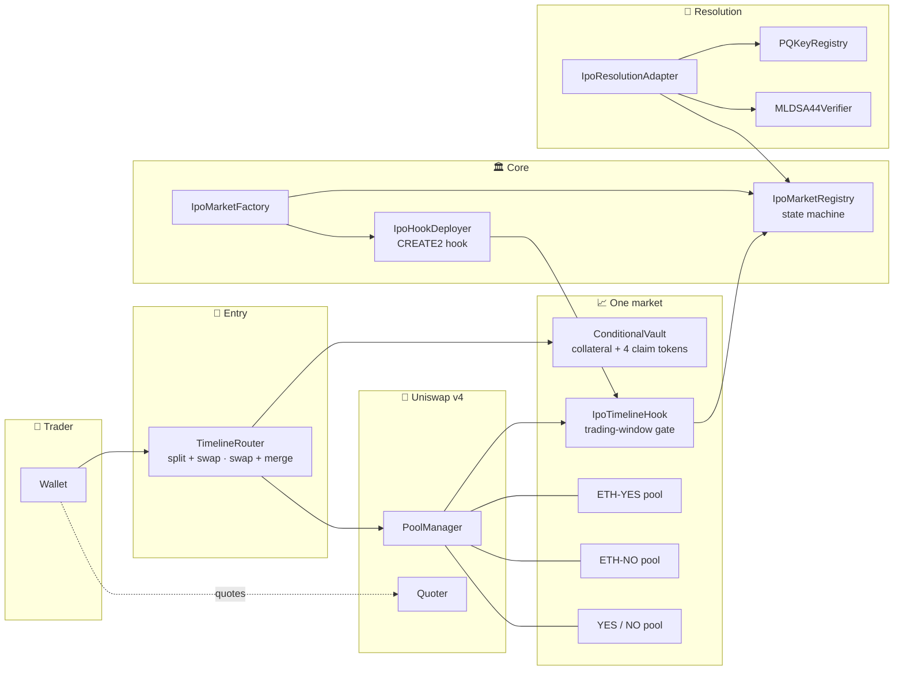
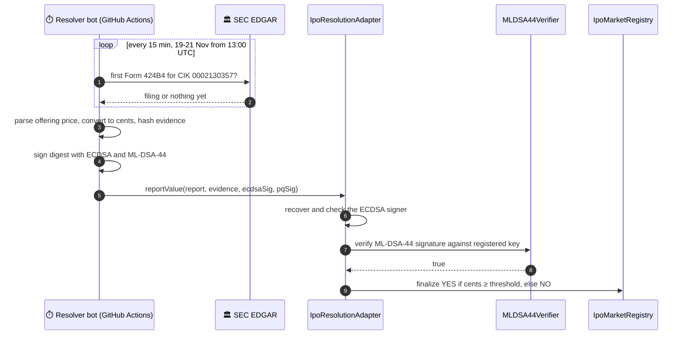

<div align="center">

# QTIMELINE

**Conditional Markets on Uniswap v4 for Robinhood Chain**

*One question. Two timelines. Resolved by a filing, not a vote.*

🌐 **App:** [www.qtimeline.tech](https://www.qtimeline.tech) · 📈 **Market:** [`/market`](apps/web/app/market/page.tsx) · 💼 **Positions:** [`/positions`](apps/web/app/positions/page.tsx) · 📜 **Rules:** [`/rules`](apps/web/app/rules/page.tsx)

*A prediction market built from three Uniswap v4 pools. Collateral is split into YES and NO claims, the market is resolved onchain from an SEC filing, and the result needs two signatures: one classical, one post-quantum.*

[](#-live-robinhood-mainnet-deployment-chain-id-4663)
[](#-tech-stack)
[](#-protocol-architecture)
[](#-smart-contracts)
[](#-how-a-market-resolves)

</div>

---

## ⚡ Overview

**QTimeline** turns a single yes-or-no question into three tradable Uniswap v4 pools on Robinhood Chain (4663). The live market asks:

> **Will Anthropic's final IPO price be at or above $74.00 per share?**

1. **Collateral becomes claims.** One USDG (or one ETH) splits into a YES claim and a NO claim. After the result, the winning claim redeems 1 : 1 and the losing claim is worth zero. Matching pairs can merge back into collateral at any time before the result.
2. **Three pools per market.** An **ETH-YES** pool prices ETH if the threshold is met, an **ETH-NO** pool prices ETH if it is not, and a **YES / NO** pool is the market's implied odds. Every pool is a standard Uniswap v4 pool with a 0.30% LP fee and no protocol fee.
3. **One trading window, enforced by a hook.** A per-market hook rejects swaps before the market opens and after the cutoff, even if someone calls the PoolManager directly.
4. **Resolved from a filing.** A bot reads the first Form 424B4 on SEC EDGAR, converts the offering price to cents, and signs the report twice. The adapter verifies both signatures onchain before the market moves to YES or NO.
5. **Cancelled safely.** If no result arrives within the resolution window, anyone can cancel and every claim redeems for 50 cents.

---

## 🏛️ Core Value Proposition

* **Settlement follows a public document.** The only input that can resolve the market is the first Form 424B4 for Anthropic, PBC. The bot parses one number, hashes the evidence, and publishes both.
* **Two signatures, checked onchain.** `IpoResolutionAdapter` accepts a report only when the ECDSA signature and the ML-DSA-44 (NIST FIPS 204) signature both verify, the latter through `MLDSA44Verifier`.
* **Trading stops before the answer exists.** The hook closes the pools at the cutoff. The earliest report can be accepted 18 hours later, so nobody can trade against a known price.
* **Hard collateral caps.** The factory refuses any market with caps above 0.1 ETH or 500 USDG of collateral, and the caps are bound into the market's config hash. Exposure is bounded by design.
* **A way out for everyone.** The hook does not implement `beforeRemoveLiquidity`, so it cannot block a liquidity withdrawal. Cancelled markets pay 50 cents per claim.
* **Quotes come from the pool.** The odds shown in the app are read from the market's own YES / NO pool through the official Uniswap v4 Quoter. No outside price feed is involved.

---

## 🔬 Protocol Architecture



### Trade routes

Every trade goes through `TimelineRouter`. Each call checks the market's config hash, status, deadline, a per-wallet nonce and a minimum output.

| Action | Router call | What happens |
|---|---|---|
| Bet on the outcome (buy) | `buyProbability` | Splits USDG into YES + NO, swaps the unwanted side in the YES / NO pool, and sends you the claims |
| Bet on the outcome (sell) | `sellProbability` | Swaps part of your position, merges the matching pair, and returns USDG |
| Buy conditional ETH | `tradeAsset` | Splits USDG, swaps the claim on one side for ETH in that world |
| Sell conditional ETH | `closeConditional` | Swaps ETH claims back to USDG claims and merges with the paired claim |

### Market lifecycle

| Status | Meaning |
|---|---|
| Scheduled | Activated, before `opensAt`. Swaps are rejected. |
| Open | Between `opensAt` and `cutoffAt`. `syncTime` is permissionless and the app sends it with the first trade. |
| Awaiting result | After `cutoffAt`. Swaps are rejected. The earliest report is accepted at `releaseAt`. |
| Final YES / Final NO | A valid dual-signed report arrived. Winning claims redeem 1 : 1. |
| Cancelled | No valid report by `deadline`. Every claim redeems for 50 cents. |

**Anthropic IPO market, all times UTC:**

| Event | Time |
|---|---|
| Trading opens | 17 Nov 2026, 18:03 UTC (13:03 ET) |
| Trading closes | 18 Nov 2026, 12:00 UTC (07:00 ET) |
| Earliest report accepted | 19 Nov 2026, 06:00 UTC |
| Cancellation opens | 21 Nov 2026, 06:00 UTC |

---

## 🔏 How a Market Resolves



Prices are US cents, so `$74.00` is `7400`. The adapter rejects a report whose source ID is not the IPO source, whose period does not match, or whose EIP-712 domain belongs to another adapter.

---

## 🖥️ Platform Interfaces

| Page | Purpose |
|---|---|
| [`/`](apps/web/app/page.tsx) | Landing page: the question, a live countdown to the cutoff, how the market works, the resolution pipeline |
| [`/market`](apps/web/app/market/page.tsx) | The question, one-tap **Buy YES / Buy NO** with live odds, the trade ticket, the three pools |
| [`/positions`](apps/web/app/positions/page.tsx) | Your four claim balances, merge before the result, redeem after it |
| [`/rules`](apps/web/app/rules/page.tsx) | Rules, payouts and risks in plain language |
| [`/vote`](apps/web/app/vote/page.tsx) | QTL voting, unavailable until the QTL token is verified |
| [`/bea-proof`](apps/web/app/bea-proof/page.tsx) | Archived BEA fixtures for the Core PCE parser |

The market page has two trade modes. **Bet on the outcome** buys YES or NO shares in the odds pool and is the default. **Trade ETH** buys or sells ETH that only exists in the YES or NO world, for people who want exposure to ETH conditional on the result. All times in the app are shown in US Eastern time.

---

## 📁 Repository Structure

```text
QTimeline/
├── apps/
│   └── web/                      # Static Next.js export (EVENT_PROFILE = pce | ipo)
│       ├── app/                  # /, /market, /positions, /vote, /rules, /bea-proof
│       ├── components/           # QuickBet, MarketTradePanel, PositionsPanel, WorldLane, landing/*
│       └── lib/                  # odds, wallet (EIP-1193 / EIP-6963), event-profile, errors
├── contracts/
│   ├── src/
│   │   ├── ipo/                  # Anthropic IPO system (upgradeable, live on mainnet)
│   │   ├── MarketRegistry.sol    # Core PCE system (immutable, testnet only)
│   │   ├── MLDSA44Verifier.sol   # FIPS 204 verifier
│   │   └── libraries/
│   ├── test/                     # Foundry unit, fuzz, invariant and mainnet-fork tests
│   ├── scripts/                  # deploy, market create, withdraw, quote, release checks
│   └── lib/evm-ml-dsa-verifier/  # ML-DSA-44 verifier (git submodule)
├── ops/resolver/                 # SEC and BEA parsers, signing and report submission
├── packages/chain/               # Robinhood Chain config and shared ABIs
├── deployments/
│   └── robinhood-mainnet-ipo.json  # Live mainnet manifest
└── docs/
    ├── qtimeline_report.md              # Project report and architecture overview
    ├── submission_package.txt    # Submission and handover report
    ├── OPERATIONS.md             # Release runbook, rehearsal evidence, testnet history
    └── PENGELUARAN-IPO.md        # Expense report for the IPO deployment
```

---

## 🛠️ Tech Stack

| Layer | Technology |
|---|---|
| Web | Next.js 15.5 static export · React 19 · TypeScript 5.9 (strict) · viem 2.57 · GSAP · Lenis · three.js |
| Contracts | Solidity 0.8.30 · EVM `osaka` · via-IR · optimizer 10,000 runs · Foundry 1.7.1 |
| AMM | Uniswap v4 core 1.0.2 · periphery 1.0.3 |
| Libraries | OpenZeppelin Contracts and Upgradeable 5.4.0 |
| Signatures | ECDSA secp256k1 + ML-DSA-44 (FIPS 204), verifier by Fireblocks Labs (submodule) |
| Resolver | Node 24 · GitHub Actions on a protected Environment |
| Hosting | Vercel (static export) |
| Package manager | pnpm 9.15 workspace |

---

## 🚀 Quickstart & Local Development

### Prerequisites

* Node 24 and pnpm 9.15
* [Foundry](https://book.getfoundry.sh/) 1.7.1
* Git with submodule support

### 1. Install

```sh
git clone --recurse-submodules https://github.com/Quantum-Timeline/QTimelineHook.git
cd QTimelineHook
pnpm install
```

### 2. Run the frontend

```sh
pnpm dev
```

### 3. Compile and test the contracts

```sh
pnpm contracts:build
pnpm contracts:test
```

### 4. Run the Node tests

```sh
pnpm contracts:test:release
pnpm --filter @qtimeline/resolver test
```

### 5. Check types

```sh
pnpm typecheck
```

### 6. Build the IPO site

```sh
pnpm web:ipo:configure   # writes apps/web/.env.ipo.local from the manifest
pnpm web:ipo:build       # static export in apps/web/out-ipo
```

The mainnet fork tests need an RPC URL in `contracts/.env`:

```sh
pnpm contracts:test:mainnet-fork
```

The full release runbook, with every deploy and market command, is in [`docs/OPERATIONS.md`](docs/OPERATIONS.md).

---

## 📜 Smart Contracts

The Anthropic IPO system lives in [`contracts/src/ipo/`](contracts/src/ipo/).

| Contract | Role |
|---|---|
| `IpoMarketFactory` | Creates a market from a config signed with ECDSA and ML-DSA-44, initializes the three pools, activates the market |
| `IpoMarketRegistry` | Market state machine, schedule parameters, permissionless `syncTime`, finalization and cancellation |
| `IpoConditionalVault` | Holds the collateral and mints four claim tokens (ETH-YES, ETH-NO, USDG-YES, USDG-NO). `split`, `merge`, `redeem` |
| `IpoOutcomeToken` | The claim token, mintable and burnable only by its vault |
| `IpoTimelineHook` | Uniswap v4 hook with flags `0x2880`: `beforeInitialize`, `beforeAddLiquidity`, `beforeSwap`. Rejects swaps outside the trading window |
| `IpoHookDeployer` | Deploys one hook per market at a CREATE2 address that satisfies the v4 permission bits |
| `IpoTimelineRouter` | Single trade entry point with config hash, status, deadline, nonce and slippage checks |
| `IpoResolutionAdapter` | Verifies the dual-signed report and finalizes the market |
| `IpoPQKeyRegistry` | Registered post-quantum public keys, sealed after setup |
| `MLDSA44Verifier` | NIST FIPS 204 ML-DSA-44 signature verification |

Core PCE contracts (`MarketRegistry`, `MarketFactory`, `ResolutionAdapter`, `TimelineRouter` and others) are the immutable predecessor system for a monthly BEA Core PCE market. They are tested on Robinhood Testnet and on a mainnet fork and are **not deployed on mainnet**.

---

## 🌐 Live Robinhood Mainnet Deployment (Chain ID: 4663)

Manifest: [`deployments/robinhood-mainnet-ipo.json`](deployments/robinhood-mainnet-ipo.json)

| Contract | Proxy / address | Deploy block |
|---|---|---|
| IpoMarketFactory | [`0xDb882dBD0da7ed65d4C360b5B18B9bd93ceAFde6`](https://robinhoodchain.blockscout.com/address/0xDb882dBD0da7ed65d4C360b5B18B9bd93ceAFde6) | 114,258,173 |
| IpoMarketRegistry | [`0x5444CF6E91462938C975668266c9E24b6233BD37`](https://robinhoodchain.blockscout.com/address/0x5444CF6E91462938C975668266c9E24b6233BD37) | 114,258,161 |
| IpoResolutionAdapter | [`0x741C847f54CeebD6A4D1A32341f73fb62eb80fbA`](https://robinhoodchain.blockscout.com/address/0x741C847f54CeebD6A4D1A32341f73fb62eb80fbA) | 114,258,179 |
| TimelineRouter | [`0x401a0A3A8e32ABaA7f66EE7247D592f47784DF45`](https://robinhoodchain.blockscout.com/address/0x401a0A3A8e32ABaA7f66EE7247D592f47784DF45) | 114,258,185 |
| PQKeyRegistry | [`0x78F42d96AD69Ed3D696875CF59eFF8A447Cd80A8`](https://robinhoodchain.blockscout.com/address/0x78F42d96AD69Ed3D696875CF59eFF8A447Cd80A8) | 114,258,167 |
| MLDSA44Verifier | [`0x668Fe10f9b424349FDD41F7E6C5DF2cC21Bf3214`](https://robinhoodchain.blockscout.com/address/0x668Fe10f9b424349FDD41F7E6C5DF2cC21Bf3214) | 114,257,982 |
| IpoHookDeployer | [`0xaAa28FA6a7DB709129879c1daF13Bc90B843064f`](https://robinhoodchain.blockscout.com/address/0xaAa28FA6a7DB709129879c1daF13Bc90B843064f) | 114,258,133 |
| F1600Helper | [`0x0438deB1f25BA0D88D257acfe89191B3EB3de75F`](https://robinhoodchain.blockscout.com/address/0x0438deB1f25BA0D88D257acfe89191B3EB3de75F) | 114,257,972 |

### The live market

| | |
|---|---|
| Market ID | `0x19d1b881668c8c8c776c92c1745daf74933b2c40c82065ba5f6017ee5e6aeafa` |
| Threshold | $74.00 (`7400` cents) |
| Hook | [`0x35A5E21FC31614a30f88D10CC35e5cD5829E2880`](https://robinhoodchain.blockscout.com/address/0x35A5E21FC31614a30f88D10CC35e5cD5829E2880) |
| Vault | [`0x7ACf9Dca7A456175ED66BbEc8B8600C9Fe6e5c0d`](https://robinhoodchain.blockscout.com/address/0x7ACf9Dca7A456175ED66BbEc8B8600C9Fe6e5c0d) |
| ETH-YES claim | [`0xE186dc05674B798deDF7059644E84A5c8F6144Eb`](https://robinhoodchain.blockscout.com/address/0xE186dc05674B798deDF7059644E84A5c8F6144Eb) |
| ETH-NO claim | [`0xe1d59cf537e8b2EB51911ea3733D8b9Ce8Ec4bD6`](https://robinhoodchain.blockscout.com/address/0xe1d59cf537e8b2EB51911ea3733D8b9Ce8Ec4bD6) |
| USDG-YES claim | [`0x45eB501957E64f5C732a9A30Cded87B77C1C5076`](https://robinhoodchain.blockscout.com/address/0x45eB501957E64f5C732a9A30Cded87B77C1C5076) |
| USDG-NO claim | [`0x75F443e26421c0c024AA3745CF074D43375e8001`](https://robinhoodchain.blockscout.com/address/0x75F443e26421c0c024AA3745CF074D43375e8001) |
| Create tx · block 116,738,977 | [`0x7f004edb…c6fb77`](https://robinhoodchain.blockscout.com/tx/0x7f004edbc4d5a255036b785b421f739406150bfeaf9685c99ac1804b40c6fb77) |
| Activate tx · block 116,739,091 | [`0x5344cff6…085c0c`](https://robinhoodchain.blockscout.com/tx/0x5344cff69d110ec3d97b511f0b354431be1c4da99a31d5d5a830c0c5cc085c0c) |

### Canonical dependencies

| Dependency | Address |
|---|---|
| Uniswap v4 PoolManager | [`0x8366a39CC670B4001A1121B8F6A443A643e40951`](https://robinhoodchain.blockscout.com/address/0x8366a39CC670B4001A1121B8F6A443A643e40951) |
| Uniswap v4 PositionManager | [`0x58daec3116aae6D93017bAAea7749052E8a04fA7`](https://robinhoodchain.blockscout.com/address/0x58daec3116aae6D93017bAAea7749052E8a04fA7) |
| Uniswap v4 Quoter | [`0x8Dc178eFB8111BB0973Dd9d722ebeFF267c98F94`](https://robinhoodchain.blockscout.com/address/0x8Dc178eFB8111BB0973Dd9d722ebeFF267c98F94) |
| USDG | [`0x5fc5360D0400a0Fd4f2af552ADD042D716F1d168`](https://robinhoodchain.blockscout.com/address/0x5fc5360D0400a0Fd4f2af552ADD042D716F1d168) |
| WETH | [`0x0Bd7D308f8E1639FAb988df18A8011f41EAcAD73`](https://robinhoodchain.blockscout.com/address/0x0Bd7D308f8E1639FAb988df18A8011f41EAcAD73) |

### Roles

| Role | Address |
|---|---|
| Deployer, owner of every ProxyAdmin and beacon, holder of the LP position NFTs | `0x3B06A7c6839dF369d62961DcA54ea56185332828` |
| Resolver signer (ECDSA) | `0xB1eeCD3799E929c01aA0aeCbb6CaDEC6d5a30801` |

The report relayer is a separate low-balance wallet that only pays gas. The ML-DSA-44 keys of the deployer and the resolver are registered in `PQKeyRegistry` and sealed.

---

## 🧪 Testing & Verification

Results from a local run on 18 Nov 2026:

| Suite | Command | Result |
|---|---|---|
| Foundry unit, fuzz and invariant | `pnpm contracts:test` | 52 passed, 0 failed, 2 skipped (fork-only) |
| Foundry mainnet fork | `pnpm contracts:test:mainnet-fork` | 9 passed, 0 failed |
| Release and withdrawal scripts | `pnpm contracts:test:release` | 18 passed |
| Resolver (SEC and BEA parsers, report builder) | `pnpm --filter @qtimeline/resolver test` | 27 passed |
| TypeScript | `tsc --noEmit` in `apps/web` | exit code 0 |

The fork suites run against the official Robinhood PoolManager and USDG and cover market creation, pool initialization, treasury LP seeding, every trade direction, cutoff enforcement on the router and on direct PoolManager swaps, LP exit, Final YES and cancellation payouts. They exercise the Core PCE contracts, with the ML-DSA verifier stubbed.

### Rehearsal of the live IPO market

The live market was rehearsed on a local fork of Robinhood Mainnet before and after creation, with the real IPO contracts, the real ML-DSA verifier and the production scripts:

* create, seed and activate with the seed that went live
* trades through the production web UI, driven by a test wallet, in every direction: buy and sell the outcome (YES and NO), buy and sell conditional ETH (both pools)
* swaps rejected after the cutoff
* the production resolver replaying a saved real Form 424B4 (Circle, $31.00) to a Final NO, and the same filing edited to $78.00 to a Final YES
* trader redemption and full treasury liquidity withdrawal in both outcomes
* the live EDGAR poll returning "no 424B4 yet", and the resolver workflow dry-run on GitHub Actions

These are fork results, not mainnet transactions by users. The only mainnet transactions so far are the deployment, market creation, seeding and activation.

---

## 🔐 Security Model

* **Dual-signature resolution.** A report needs a valid ECDSA signature from the registered signer and a valid ML-DSA-44 signature from the registered post-quantum key. Both are checked in `IpoResolutionAdapter`.
* **Source pinning.** A report must carry the IPO source ID and the market's period, and is bound to the adapter's EIP-712 domain.
* **Time gates in two places.** The hook rejects swaps outside the window, and the vault rejects `split` after the cutoff even if the registry status is stale.
* **Config binding.** Every trade carries the market's config hash. A router call for a different config reverts.
* **Collateral caps.** At most 0.1 ETH and 500 USDG of collateral per market, enforced by the factory at creation.
* **Permissionless cancellation.** Once the deadline passes without a valid report, anyone can call `cancelExpired` on the adapter.
* **No hook on liquidity removal.** The hook has no `beforeRemoveLiquidity`.

### Trust assumptions

These are real, and they matter more than the list above:

* **The core contracts are upgradeable.** The registry, key registry, factory, adapter and router are OpenZeppelin `TransparentUpgradeableProxy` instances. Each market's vault, claim tokens and hook are `BeaconProxy` instances behind three `UpgradeableBeacon`s. The deployer wallet owns every ProxyAdmin and beacon with no timelock, so it can replace logic, including vault logic that holds collateral. This is a trust assumption on one key. Core PCE has no such powers.
* **The resolver is operated by the project.** The ECDSA key and the ML-DSA-44 key are both controlled by the project, so the dual signature protects against a single leaked key, not against the project itself. Evidence and its hash are published with every report.
* **No independent audit or cryptographic review has been completed.** These remain release gates in [`docs/OPERATIONS.md`](docs/OPERATIONS.md).
* **Liquidity is thin.** The market opened with small seed liquidity, so a single $5 trade moves the YES / NO price by about 3% and the ETH pools by about 6%.

---

## 🧭 Known Limitations

* The Positions page was not re-checked in a visible browser tab after a merge. In a hidden tab the balance animation did not update, while the onchain balance was correct.
* QTL voting is not available.
* The app has no fiat on-ramp. A trader needs a wallet on Robinhood Chain with USDG and a little ETH for gas.
* The public Robinhood RPC is blocked or intercepted by some ISPs and DNS resolvers, so the production site uses a keyed RPC.

---

## 📚 Documentation

| Document | Purpose |
|---|---|
| [`docs/qtimeline_report.md`](docs/qtimeline_report.md) | Project report and architecture overview |
| [`docs/submission_package.txt`](docs/submission_package.txt) | Submission and handover report |
| [`docs/OPERATIONS.md`](docs/OPERATIONS.md) | Release runbook, fork rehearsal evidence and testnet history |
| [`docs/PENGELUARAN-IPO.md`](docs/PENGELUARAN-IPO.md) | Expense report for the IPO deployment |
| [`QTimeline-Implementation-Plan.md`](QTimeline-Implementation-Plan.md) | Implementation decisions and release checklist |
| [`ops/resolver/README.md`](ops/resolver/README.md) | Resolver operations and secrets |

---

## 🔎 Verify QTimeline Onchain

Read the market state and the proxy wiring yourself with [Foundry `cast`](https://book.getfoundry.sh/cast/):

```sh
RPC=https://rpc.mainnet.chain.robinhood.com

# Market record, raw ABI output. The status field is 0 Draft, 1 Scheduled, 2 Open,
# 3 Awaiting result, 4 Final YES, 5 Final NO, 6 Cancelled
cast call 0x5444CF6E91462938C975668266c9E24b6233BD37 \
  "market(bytes32)" 0x19d1b881668c8c8c776c92c1745daf74933b2c40c82065ba5f6017ee5e6aeafa --rpc-url $RPC

# Implementation behind a proxy (ERC-1967 slot)
cast implementation 0x5444CF6E91462938C975668266c9E24b6233BD37 --rpc-url $RPC

# Deployed code is present
cast code 0xDb882dBD0da7ed65d4C360b5B18B9bd93ceAFde6 --rpc-url $RPC | head -c 80
```

The manifest also lists every implementation, ProxyAdmin and beacon address under `upgradeControl`.

---

## 📄 License

No license has been published for this repository yet.
